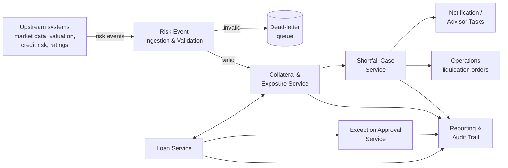

# Collateral Lending & Risk Platform

An educational, event-driven system showing how a private bank lends against a client's stocks, bonds and property, and how it processes risk events — price drops, rating downgrades, collateral shortfalls — from upstream systems through to client advisors, credit officers and regulatory reporting.

The business rules are modelled on **Swiss private-bank practice** (Lombard lending and mortgages).

> ⚠️ **Learning project.** This is not a production banking system and contains no real client data. Thresholds and rules are illustrative and configurable.

---

## Business domain in 60 seconds

| Concept | Meaning |
|---|---|
| **Collateral** | Assets a client pledges as security for a loan (stocks, bonds, funds, cash, property). |
| **Haircut** | Discount applied to an asset's market value for risk, e.g. equities 40%, high-grade bonds 20%. |
| **Lending value** | Market value minus haircut — what the bank will lend against. |
| **Lombard loan** | A loan secured by a pledged securities portfolio. |
| **LTV (loan-to-value)** | Loan amount ÷ collateral value; capped by bank policy. |
| **Collateral shortfall** | Exposure exceeds lending value, usually after a market drop or downgrade. |
| **Margin call** | Demand that the client restores coverage by adding collateral or repaying. |
| **Exception approval** | Approval to lend beyond policy, signed off per the bank's credit competence matrix. |

### Shortfall escalation (illustrative thresholds)

1. **Early warning** (~90% utilisation) → client advisor informs the client.
2. **Margin call** (>100%) → advisor contacts the client; client must cure within a deadline. New loans are blocked.
3. **Close-out** (~110–120% or deadline missed) → credit risk may order forced liquidation.

---

## Architecture (planned)



| Service | Responsibility |
|---|---|
| `risk-event-service` | Consumes upstream risk events; schema, reference-data, duplicate and business-rule validation. |
| `collateral-service` | Holds positions, valuations, haircuts and lending values per client. |
| `loan-service` | Loan requests, approval / partial approval / rejection, disbursement, credit holds. |
| `shortfall-service` | Tracks shortfall cases: warning → margin call → cured / escalated / liquidated. |
| `exception-service` | Unauthorised excesses and exception-to-policy approvals with time limits. |
| `notification-service` | Advisor tasks and client notifications. |
| `event-tracking-service` | End-to-end status of every event by correlation ID. |

Every service owns its own PostgreSQL schema and publishes events via the **transactional outbox** pattern.

---

## Tech stack

- **Java 21**, **Spring Boot 3**, Maven multi-module
- **Apache Kafka** — idempotent producers, consumer groups, retries, dead-letter topics
- **PostgreSQL** — one schema per service, Flyway migrations
- **Docker Compose** for local development
- **Testing** — JUnit 5, Testcontainers, Cucumber, Selenium
- **CI/CD** — GitHub Actions, GitHub Container Registry
- **IDE** — IntelliJ IDEA Community Edition

---

## Getting started

> Instructions will be added as services are built.

```bash
git clone https://github.com/<your-username>/collateral-lending-risk-platform.git
cd collateral-lending-risk-platform
docker compose up -d        # start Kafka, create topics, start Kafka UI
docker compose down         # stop everything
```
Kafka UI: http://localhost:8080 · Kafka for local apps: `localhost:9092`

**Prerequisites:** JDK 21, Docker Desktop, Git, IntelliJ IDEA Community.

---

## Roadmap

- [ ] Multi-module Maven skeleton
- [ ] Local Kafka + PostgreSQL with Docker Compose
- [ ] Risk event ingestion and validation
- [ ] Collateral valuation and lending value calculation
- [ ] Loan approval against available limit
- [ ] Shortfall escalation and credit holds
- [ ] Exception and unauthorised-excess approvals
- [ ] End-to-end event tracking (outbox + status table)
- [ ] CI/CD with GitHub Actions
- [ ] Cucumber + Selenium acceptance tests
- [ ] GitHub Copilot instructions, prompts and agents

---

## License

Licensed under the Apache License 2.0 — see [LICENSE](LICENSE).